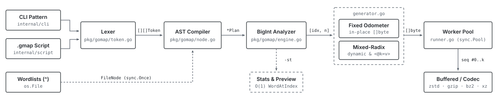

<p align="center">
  <br>
  <a href="https://github.com/pwnfo/gomap" target="_blank"></a>
  <br>
  <span>Generate high-performance wordlists using pattern logic and expressions</span>
  <br>
</p>

<p align="center">
  <a href="#installation">Installation</a>
  &nbsp;&nbsp;&nbsp;•&nbsp;&nbsp;&nbsp;
  <a href="#usage">Usage</a>
  &nbsp;&nbsp;&nbsp;•&nbsp;&nbsp;&nbsp;
  <a href="#architecture">Architecture</a>
  &nbsp;&nbsp;&nbsp;•&nbsp;&nbsp;&nbsp;
  <a href="docs/index.md">Documentation</a>
  &nbsp;&nbsp;&nbsp;•&nbsp;&nbsp;&nbsp;
  <a href="#contributing">Contributing</a>
</p>

Gomap is a compiled, zero-CGO wordlist generator written in Go. It parses character classes, quantifiers, numeric ranges, external files, value bindings, and `.gmap` scripts to generate targeted wordlists and datasets with minimal memory overhead.

## Architecture

<p align="center">
  
</p>

## Installation

| Method | Command |
| :--- | :--- |
| Go install | `go install github.com/pwnfo/gomap/cmd/gomap@latest` |
| Build from source | `git clone https://github.com/pwnfo/gomap.git && cd gomap && make build` |

## Usage

Generate a wordlist from an expression:
```bash
gomap '/l{2,4}'
```

Combine external files with patterns:
```bash
gomap '^:^' users.txt pass.txt -o creds.txt
```

Run across all CPU cores with streaming compression:
```bash
gomap '/H{6}' -w 0 -z zstd -ft 1MB -zl 3 -o hashes.txt.zst
```

```console
General Options:
  -h, -help                    show this help message and exit
  -v, -version                 show version information and exit
  -st, -stats                  show pattern statistics and exit
  -q, -quiet                   suppress non-essential output
  -n, -non-interactive         skip the confirmation prompt before execution

Generation Options:
  -d, -delimiter <string>      string inserted between generated entries (default: "\n")
  -b, -write-buffer <size>     output I/O buffer size (default: 1MB)
  -w, -workers <0-256>         number of worker goroutines, 0 = auto CPU cores (default: 1)
  -ft, -flush-threshold <size> flush chunk buffer after reaching byte threshold (default: 512KB)

Input Options:
  -f, -file <path>             load patterns from .gmap file ("-" for stdin)
  -s, -start <word>            start writing output from <word>
  -e, -end <word>              stop writing output at <word>

Output Options:
  -o, -output <path>           write output to a file
  -fo, -force                  overwrite existing compressed output file
  -z, -compress <format>       compress output (supported: gzip, zstd, bzip2, lzma)
  -zl, -compresslevel <level>  compression level for the selected format
```

### Expression basics

* Literal characters produce themselves.
* Built-in classes and bracketed classes `[...]` produce one item per position.
* Concatenation combines positions left-to-right.

```bash
$ gomap '/l{2,3}' -q -n
# output: aa, ab, ac, ..., ZY, ZZ
```

### Character classes

| Symbol | Meaning |
| :--- | :--- |
| `/l` | letters (`a-z`, `A-Z`) |
| `/a` | lowercase letters (`a-z`) |
| `/A` | uppercase letters (`A-Z`) |
| `/d` | digits (`0-9`) |
| `/D` | non-zero digits (`1-9`) |
| `/h` | lowercase hexadecimal (`0-9`, `a-f`) |
| `/H` | uppercase hexadecimal (`0-9`, `A-F`) |
| `/o` | octal digits (`0-7`) |
| `/p` | special characters (`!@#$%^&*-_+=`) |
| `/s` | space |
| `/b` | newline (`\n`) |

### Custom classes, groups, and alternation

* `[abc]` selects one character from `a`, `b`, or `c`.
* `[admin|root|123]` selects one full-word alternative separated by `|`.
* `(admin){3}` treats the enclosed sequence as a single literal unit (`adminadminadmin`).
* `admin/d||guest/d` chains multiple top-level expressions sequentially.

### Statistics

Analyze a pattern and preview its combination space before generating entries using `-st` / `-stats`:

```bash
gomap -st '/l{4}||#[01-12]/d{2}'
```

### Quantifiers

* `{N}` repeats the preceding token `N` times.
* `{min,max}` repeats between `min` and `max` times (inclusive).
* `?` makes the preceding token optional (`0` or `1` time).

```bash
$ gomap '[XYZ]{3}'       # XXX, XXY, ..., ZZZ
$ gomap '[XYZ]{2,5}'     # XX, XY, ..., ZZZZZ
$ gomap 'Ryan?/d'        # Rya0, Rya1, ..., Ryan9
$ gomap '[XYZ]?Ryan'     # Ryan, XRyan, YRyan, ZRyan
```

### Numeric ranges

* `#[1-10]` generates `1, 2, ..., 10`
* `#[1-10:2]` generates `1, 3, 5, 7, 9`
* `#[10-2:-2]` generates `10, 8, 6, 4, 2`
* `#[01-12]` preserves leading zero-padding (`01, 02, ..., 12`)

### Files and placeholders

Each `^` placeholder consumes one positional file argument and iterates over its lines:

```bash
$ gomap '^/d' names.txt
$ gomap '^-^' names.txt years.txt
```

Prefix an argument with `//` to inject an inline expression instead of a file path:

```bash
$ gomap 'svc-^-^' '//[dev|prod]' '//#[1-3]'
```

### Value bindings

Use `<@name=expr>` to evaluate an expression once per entry and reuse the value with `<@name>` without creating a Cartesian product:

```bash
$ gomap '<@d=/d>-<@d>'           # 0-0, 1-1, ..., 9-9
$ gomap '<@x=^>:<@x>' words.txt  # foo:foo, bar:bar, ...
$ gomap '<@n=/d{2}>_<@n>'        # 00_00, 01_01, ..., 99_99
```

### Script files (`.gmap`)

Define reusable `%define` macros and `%include` file bindings inside `.gmap` files (see [`examples/`](examples/)):

```text
%define YEAR #[1990-2030]
%define MONTHS_31 [01|03|05|07|08|10|12]

#[01-31]$MONTHS_31;$YEAR;
```

Run with:
```bash
gomap -f examples/dates_dmy.gmap -o dates.txt
```

### Compression

Gomap supports streaming compression when writing output files:

```bash
gomap '/l{5}' -z zstd -o wordlist.txt.zst
gomap '/l{5}' -z gzip -o wordlist.txt.gz
gomap '/l{5}' -z bzip2 -o wordlist.txt.bz2
gomap '/l{5}' -z lzma -o wordlist.txt.xz
```

### Escaping special characters

Use `\` to escape reserved characters:

```bash
$ gomap '\/d/d'
# output: /d0, /d1, ..., /d9
```

## Documentation

Full documentation is available at [gomap.readthedocs.io](https://gomap.readthedocs.io/) and in [`docs/`](docs/index.md):

* [Installation & Cross-Compilation](docs/installation.md)
* [CLI Reference](docs/cli-reference.md)
* [Expressions, Classes & Quantifiers](docs/expressions.md)
* [Numeric Ranges & File Placeholders](docs/ranges-and-files.md)
* [Scripts, Bindings, Seeking & Concurrency](docs/advanced.md)
* [Streaming Compression](docs/compression.md)
* [Go Library (`pkg/gomap`)](docs/library.md)

## Contributing

Contributions are welcome. Feel free to open an issue or submit a pull request at `pwnfo/gomap`.

## License

MIT © Ryan R. &lt;pwnfo@proton.me&gt;
