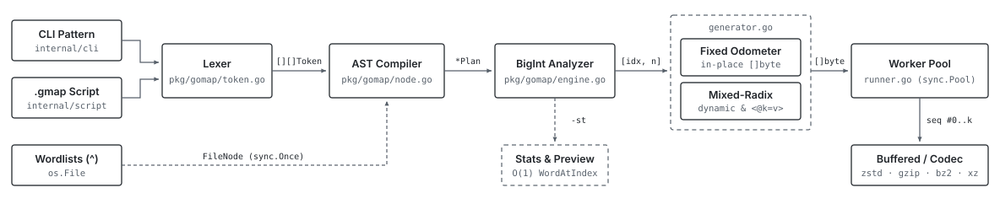

# Gomap Documentation

Gomap is a compiled, zero-CGO wordlist generator written in Go. It parses character classes, quantifiers, numeric ranges, external wordlists, value bindings, and `.gmap` scripts to generate datasets deterministically at high throughput.

## Guides

1. [Installation & Building](installation.md)
2. [CLI Reference & Flags](cli-reference.md)
3. [Expressions, Classes & Quantifiers](expressions.md)
4. [Numeric Ranges & File Placeholders](ranges-and-files.md)
5. [Advanced Concepts: Scripts, Value Bindings, Seeking & Concurrency](advanced.md)
6. [Streaming Compression Guide](compression.md)
7. [Go Library (`pkg/gomap`) Reference](library.md)

## Architecture Overview

  

## Design Overview

* **Compact Patterns**: Express large permutation spaces concisely with classes, unions, ranges, and bindings.
* **Zero-Allocation Hot Paths**: Fixed-width expressions execute on pre-allocated `[]byte` buffers; dynamic expressions use an in-place mixed-radix walker without per-word string allocations.
* **Mathematical Seeking**: `-start` and `-end` resolve global mixed-radix indices directly instead of iterating from the beginning.
* **Deterministic Concurrency**: Multi-worker execution (`-w`) partitions index ranges across goroutines using `sync.Pool` and writes chunks in strict sequential order.
* **Scriptable Rules**: `.gmap` files organize multi-part patterns with `%define` macros and `%include` wordlist bindings.
